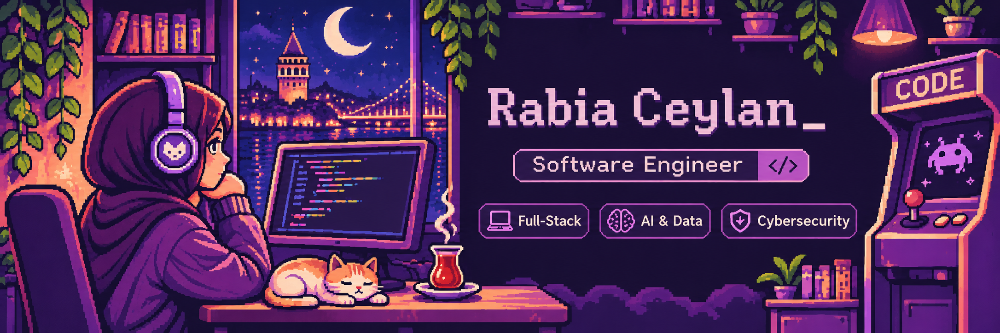
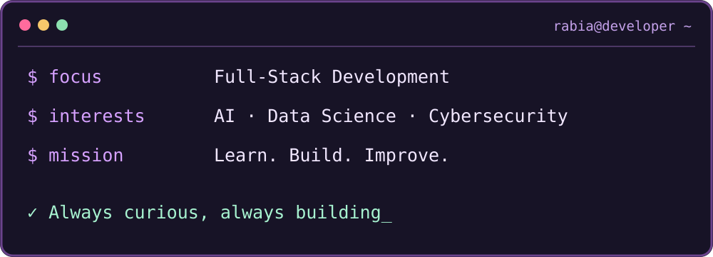

**💜 Software Engineer | Full-Stack Development**

*Building meaningful digital experiences, one project at a time.*

---

## 💜 01 / About the Developer

Hey! I'm Rabia, a Software Engineering graduate who loves turning ideas into real applications.

I'm currently exploring new technologies, strengthening my skills, and building projects that challenge me to grow.

---

## ⚡ 02 / Tech Stack

### 🎨 Frontend

### ⚙️ Backend

### 🧰 Tools & Technologies

---

## 🚀 03 / Featured Project

### 💬 [Connecta — Real-Time Video Chat](https://github.com/rabiaceylan/connecta)

A browser-based, one-to-one video calling and instant messaging application.

**Features**
- Real-time video and audio communication
- Instant messaging with WebSocket
- Meeting rooms with shareable room codes
- Camera and microphone controls
- Browser-based access without installation

**Built with:** WebRTC · WebSocket · Node.js · Express

📸 View Connecta Screenshots

 

**Home Screen**

 

**Meeting Room**

---

## 💌 04 / Let's Connect

I'm always happy to connect with fellow developers, exchange ideas, and explore new opportunities.

---

*💜 Thanks for visiting my little corner of GitHub!*

